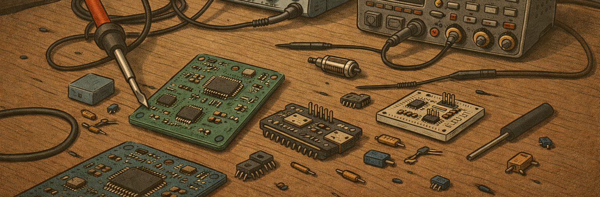

# 👋 Hi, I’m Guilherme Freire
> Embedded Software Engineer · Master's in Computational Modeling · São Paulo, Brazil
- 🔧 I’m currently working at **Toradex** on [Torizon OS](https://github.com/torizon) 🧇
- 🌱 I’m going deeper into **Zephyr RTOS**, embedded Linux and AI-assisted embedded development
- 📫 How to reach me: [linkedin](https://www.linkedin.com/in/guilherme-freire-almeida)

# 💻 Tech Stack:
 
 
 
 
 
![Yocto](https://img.shields.io/badge/Yocto-333333?style=for-the-badge&logo=data%3Aimage%2Fpng%3Bbase64%2CiVBORw0KGgoAAAANSUhEUgAAACAAAAAgCAYAAABzenr0AAADkklEQVR42rWXT2hcVRTGf%2FdlNDHWNpomoUTUQoXaYK240BJLIXWhNtKkiqLgQtSNG1Fc6EoR910oSl10oUaFVrEmKnahFV34p1grbcViaVEsNWCxiI1JZ97PRc7oY5x0ZtrMgcth3ptzv%2Ft999xzz4MaUy9Te2jB1KT2qNeol3A%2BFsAj6oT6rrqyOnkj8PD3qHvV59SVatYotpbBY%2Box521OfabRAiIuqctj4aoz6p5mCWQAKSWB08CSeF4CtqjXppQ8xyQpYjcCm4Ac6AL6Yw6ARJMSLlPfUStqrp5Rn1dL9RZQiOtTXwv2uTqrPqle3NIWhB9Xp%2F3PDqg315OyELNF%2FS3AVfepQ%2FEua4Rd%2B4e9MSqAwBpgTC3VgsfWLAfuDsmJuLeAI7FAWzpK4UfUXwsqfFerQsGPhmJV9l%2Bp1zfLvp4CAF8DHxZUGAK2ql3ViYN9L3Af0Fdgvws4HArldVimf0cDFTaqJwqJdVzdFO86wt%2Bpniwo9aW6thX2CykA8A3werACuBoYV5cCuXoF8ECwFygDk8DBBdljWv%2By%2FVsnXL1huytgnmxWc6gNic%2BEnD%2FGORYYA26Kc78eGIn4BHwLTC0oOzC6gxsHethGxht93bw6NsEwz5qV6u%2BECTgIvAdcF88HIxeOxt4PROEpAx8B31dPR5E1KXnbdpd1djKey2hepjPLWJ3B77ev4nipTmmrqjCj7gY2AzfE6%2FtDjQ0F9Q4Au%2BpWTOf1mYVuZRAomTidQycw0JXTnS1QX%2FNIpH3Am8BcTNcLPAxcGX%2BdBT5OKR38P3sgJdH0%2BeVMA5%2BSOJkllnTk%2FMUcX3iK6dK5SkOwmgLuAm4NybvDAxwC3m6Y6vemSmWbk%2FaSOjpYm3Vw9GyJ3e8%2Fkf5otjg9rf4dRzIv3BUv1BanRbXC5KviilUtFyrkmubBTdWj10wdqM2Jn4CfC9frWeAz4EjzdJLz4zwWEPV9qBBzAtgJVOomXwuWNQFeAsaBdfGoDHwA7L8Q4Fb2fzj6gqr9og63LfFqwJeqr0SXVA7%2FUtwJ7cv8wnik5sb7Qb2lLeABmBV%2Bb1YPF67kGfUp9aJFX0Bxsvg%2BeFDdH%2BCV8DvVq9op%2FQr1DvXFQjNSBd9TaDYWXfpB9fH4GjpW2O%2B8AL6uncz71Kk6wH%2BqO1ppsS9kEY%2BqpwrJ9on6kNrfbvDqV89k9PZd0QMcivpf7YJz2m3xaXZpbT1oN%2B4%2FtibI1xmPy3UAAAAASUVORK5CYII%3D) 
 
 
 

 

# 📊 GitHub Stats:

 

   
  
  

 

---
